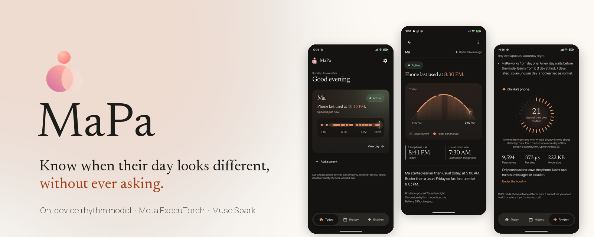
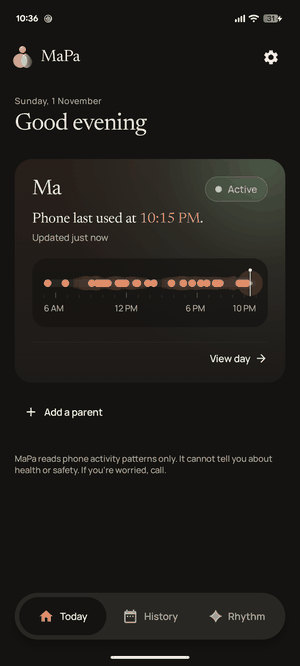
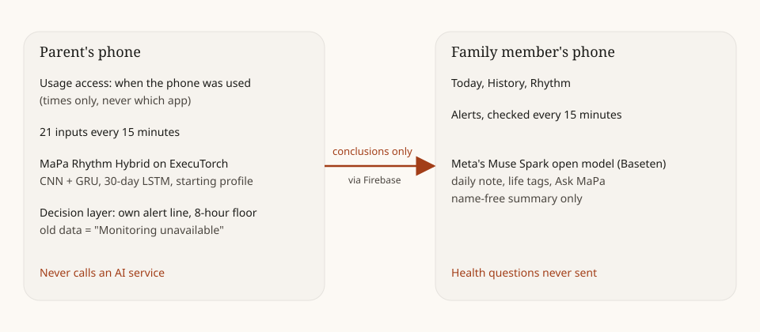
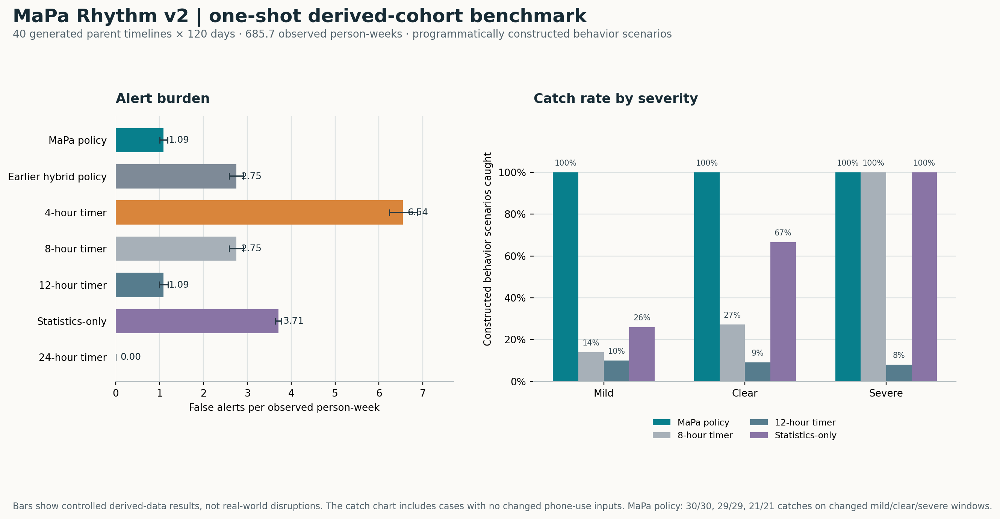
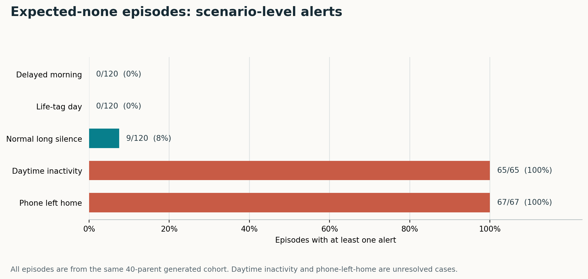

<div align="center">



<br>

**A small AI model on your parent's phone learns their daily rhythm.<br>You see one calm picture of their day, and hear the same day when it looks different.**

[**Watch the demo**](#) · [Landing page](#) · [Try the APKs](#try-it-in-2-minutes) · [Model card](models/MODEL_CARD.md) · [Dataset card](data-card/DATASET_CARD.md)

     

</div>

## MaPa at a glance

| | |
|---|---|
| **Idea** | Each parent's phone scores that parent's own rhythm, starting from a population profile, with a 12-hour observed-quiet backstop. |
| **Model** | Our 9,594-parameter model (CNN + GRU + 30-day LSTM), trained from scratch, exported to ExecuTorch and wired into the Android app. On-device runtime is not yet verified. |
| **Current evaluation** | V2 decision policy: 1.09 false alerts per observed person-week; 50/50 mild, 33/33 clear, and 25/25 severe behavior scenarios detected on a fresh 40-parent derived cohort. |
| **App build** | Signed parent and family release APKs are available in [GitHub Releases](https://github.com/shreyash-sharma/MaPa/releases). Firebase credentials are not included in the source repository. |
| **Meta** | ExecuTorch/XNNPACK for the Android inference path; Muse Spark via Baseten for family-app text features. |

<div align="center">
<br>
<sub>The family app and the parent app on a Pixel 6a (sample data).</sub>
</div>

## The problem

Many Indian parents live on their own, while their children work in another city or another country.
A daily "Are you up? Did you eat?" call feels like checking up on them.
Alarm apps wait on a fixed timer and know nothing about the person.

| A 24-hour timer app | MaPa |
|---|---|
| Waits a fixed time, the same for everyone | Learns when *this* parent usually starts and spends the day |
| A quiet morning stays silent until the timer runs out | The family hears the same day when a day looks very different |
| One alarm, nothing in between | One calm picture every day, and an alert only when it matters |

## How it works

<div align="center"></div>

1. **Family sets it up, parent taps Yes.** The parent also allows two permissions: usage access and physical activity.
2. **Every 15 minutes** the parent's phone notes whether it was used. The time only, never which app.
3. **The MaPa Rhythm Hybrid** scores the day against this parent's own rhythm, on the phone.
4. **Only the conclusion travels:** Active, Quiet, Unusual, Monitoring unavailable or Paused by parent.

## The model

| Parameters | Inputs | Exported programs | On-device measurement |
|---:|---:|---:|---|
| 9,594 | 21 per 15 minutes | ExecuTorch step and daily programs, 103,684 + 123,136 bytes | Not measured for this release |

A CNN and a GRU read today, a 30-day LSTM reads recent days, and a starting profile lets it start from the first day (day-one catch is shown on one staged day only).
Trained on real smartphone logs and parent timelines generated by a statistical model fitted to those logs. The benchmark's behavior scenarios are programmatically added to derived timelines; they are not naturally observed events.

## Results

The current release uses the trained neural checkpoint with an updated decision policy. The policy was evaluated once in Python on 40 newly generated derived parent timelines (120 days each; seed `2026110202`; 685.7 observed person-weeks). The test cases are controlled behavior scenarios on derived timelines, not an on-device run, real-world user study, or test on observed emergencies.

<p align="center"></p>

| Method, same derived cohort | False alerts / observed person-week | Mild caught | Clear caught | Severe caught |
|---|---:|---:|---:|---:|
| **MaPa policy** | **1.0938** (95% person-bootstrap CI: 1.0077–1.1885) | **50/50** | **33/33** | **25/25** |
| Earlier hybrid policy | 2.7504 (2.5885–2.9152) | 50/50 | 33/33 | 25/25 |
| 4-hour timer | 6.5421 (6.2402–6.8673) | 30/50 | 33/33 | 25/25 |
| 8-hour timer | 2.7504 (2.5885–2.9152) | 7/50 | 9/33 | 25/25 |
| 12-hour timer | 1.0938 (0.9975–1.1929) | 5/50 | 3/33 | 2/25 |
| Statistics-only | 3.7085 (3.6370–3.7757) | 13/50 | 22/33 | 25/25 |
| 24-hour timer | 0 | 0/50 | 0/33 | 0/25 |

The false-alert measure is an alert-event rate per observed person-week. A scenario counts as detected if an alert occurred within its defined window. The v2 row alerted during 141/492 (28.66%) expected-none hard-negative windows. This average hides a clear weakness:

<p align="center"></p>

It alerted on every daytime-inactivity case (65/65) and phone-left-home case (67/67). The phone-use inputs cannot tell whether the person is inactive or the phone is away. Also, 20 mild, 4 clear, and 4 severe positive windows were no-ops where the scenario left phone-use inputs unchanged; among changed windows, detection was 30/30, 29/29, and 21/21. Observation cases were counted separately (160/160 per severity group). Median and p90 behavior alert delay were both 60 minutes.

The results support a controlled derived-data comparison only. They do not establish emergency detection, real-world performance, or an improvement caused by the neural network alone. The Android policy is integrated, but this cohort was not evaluated on a phone and Kotlin/Python end-to-end parity has not been measured. The Hugging Face package retains the earlier locked evaluation and its artifacts in a separate [historical archive](https://huggingface.co/shreyashsharma/MaPa-Rhythm-Base/tree/main/evaluation-v1); those results are not combined with this cohort. See the [model card](models/MODEL_CARD.md), [detailed v2 evaluation](https://huggingface.co/shreyashsharma/MaPa-Rhythm-Base/blob/main/evaluation-v2/RESULTS-v2.md), [raw aggregate metrics](https://huggingface.co/shreyashsharma/MaPa-Rhythm-Base/blob/main/evaluation-v2/metrics.json), [chart data](docs/benchmark-v2.csv), and [figure generator](docs/plot-benchmark-v2.py).

## What is real, and what is sample data

| Completed artifact or check | Not established by this benchmark |
|---|---|
| A 9,594-parameter checkpoint and ExecuTorch exports; Android release APKs compile and are signed | Runtime performance and Python/Kotlin parity on a Pixel 6a |
| A one-shot evaluation on generated timelines with programmatically added behavior scenarios | Detection of naturally occurring disruptions or emergencies |
| Firebase project configuration is present in the local build setup | End-to-end sign-in, pairing, and family sync on a physical phone |
| Screenshots and tour use sample timelines | Real family pilot data (pilot not started) |

## How we use Meta (with proof)

| | What it does | Code |
|---|---|---|
| **ExecuTorch** | The Android inference path uses XNNPACK. Export parity against the Python reference is 2.4e-6; end-to-end phone latency has not been measured for this release. | [export](mapa-android/routine-engine/ml/mapa_train/export_hybrid.py) · [phone loader](mapa-android/app/parent/src/main/kotlin/app/mapa/parent/rhythm/ExecuTorchHybrid.kt) · [pipeline](mapa-android/routine-engine/engine/src/main/kotlin/app/mapa/routine/HybridPipeline.kt) |
| **Muse Spark open model**, via Baseten | Daily note (English, Hindi; Marathi and Tamil after a back-translation check), life tags from the family's words, Ask MaPa. It sees a name-free summary only. | [client](mapa-android/app/core/src/main/kotlin/app/mapa/core/cloud/ChatClient.kt) · [translator](mapa-android/app/core/src/main/kotlin/app/mapa/core/cloud/NoteTranslator.kt) · [spend caps](mapa-android/app/core/src/main/kotlin/app/mapa/core/cloud/AiBudget.kt) |

## Built to hold up

- **Only conclusions leave the phone.** No GPS, camera, microphone, messages or app names. The parent's phone never calls an AI service.
- **Old data is never a good day.** A silent phone shows "Monitoring unavailable".
- **Illness is not learned as normal.** New days wait before they are learned; tagged days (unwell, travelling, guests, festival) are skipped.
- **Security rules with tests.** Firestore rules are tested ([rules tests](mapa-android/app/backend/rules-test)).
- **No AI key in the public app; spend caps** on every cloud call. Health questions are answered on the phone and never sent.

## Reproduce

```bash
cd mapa-android/app
# Phone parity, the full pipeline golden check, rules and wire tests
./gradlew :routine-engine:test :core:test -PmapaModels=../routine-engine/models
# Python features match the phone
cd ../routine-engine/ml && python -m mapa_train.parity --features-only
```

The held-out evaluation needs the [MaPa-Rhythm dataset](https://huggingface.co/datasets/shreyashsharma/MaPa-Rhythm) (Hugging Face).

## Try it in 2 minutes

<details>
<summary><b>Install the APKs</b></summary>

1. Download `MaPa-Parent-v0.1.0.apk` and `MaPa-Family-v0.1.0.apk` from [Releases](https://github.com/shreyash-sharma/MaPa/releases).
2. Family phone: open MaPa Family, tap **Continue with Google**, then **Add a parent**.
3. Parent phone: open the link, tap **Yes, share**, turn on the switch.
4. Android 13 and later: if the switch says "Restricted setting", open App info, tap ⋮, tap **Allow restricted settings**.

</details>

<details>
<summary><b>Build from source</b></summary>

Requirements: JDK 17 and Android SDK 35. `./gradlew :parent:assembleRelease :family:assembleRelease` in `mapa-android/app` (release signing credentials are required).
Without a `google-services.json` the apps use the local Firebase Emulator Suite (`backend/`).

</details>

## Why we built it

> I live away from my parents, and like many adult children, I often wonder how their day is going. Calling them repeatedly isn't practical, and I don't want to make them feel monitored through cameras, GPS trackers or wearables. What I really want is a simple way to know whether their everyday routine seems normal. MaPa uses the smartphone they already carry to learn their activity patterns and identify unusual periods of inactivity. With their consent, it helps families know when a gentle check-in might be worthwhile, without compromising their privacy or independence.
>
> — Shreyash Sharma, founder

<details>
<summary><b>Repository map</b></summary>

| Folder | Contents |
|---|---|
| [`mapa-android/app`](mapa-android/app) | Parent and family apps (Kotlin, Jetpack Compose), Firebase rules |
| [`mapa-android/routine-engine`](mapa-android/routine-engine) | On-device engine, the Kotlin model, parity tests, training code (`ml/`) |
| [`models`](models) | The two ExecuTorch programs and the model card |
| [`data-card`](data-card) | Dataset card, licences and credits |
| [`landing_site`](landing_site) | The landing page (Next.js) |
| [`docs`](docs) | Design notes, status, submission text |

</details>

## Licence and credits

Code and model: [Apache 2.0](LICENSE). Please keep the [NOTICE](NOTICE) and cite with [CITATION.cff](CITATION.cff).
Data sources (CC BY 4.0): the S3 dataset (Espin Lopez et al., figshare) and UbiqLog (Rawassizadeh, UCI).
Methods we built on: Shen et al. 2025, Gibietz et al. 2026, Cejudo et al. 2025 (cited in the model card).

Built for the Meta AI Developer Hackathon (2026).

<div align="center"><sub>MaPa · for families who live apart</sub></div>
