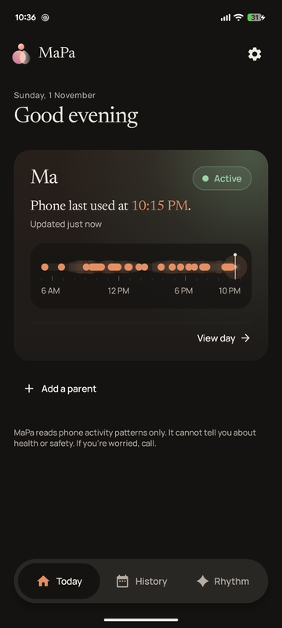
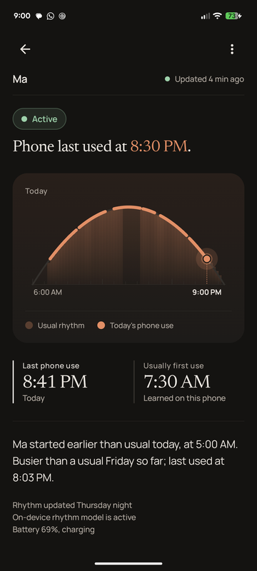
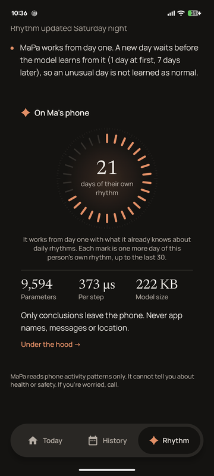
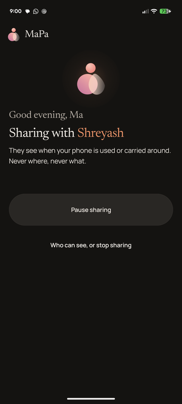

<div align="center">


# MaPa

**Know when their day looks different, without ever asking.**

A small AI model on your parent's phone learns their daily rhythm. You see one calm picture of their day.

[Demo video](#) · [Landing page](#) · [Download the APKs](#try-it) · [Model card](models/MODEL_CARD.md)

    

<br>

   

<sub>Family app: Today, the day view, the model on the phone. Parent app: one screen. (Sample data.)</sub>

</div>

---

## The problem

Many Indian parents live on their own, while their children work in another city or another country.
A daily "Did you eat? Are you up?" call feels like checking up on them.
Alarm apps wait for a fixed timer, often a whole day, and know nothing about the person.

## What MaPa does

- **Learns one person's rhythm.** A model on the parent's phone learns when *this* parent usually starts and spends the day.
- **Shows one calm picture.** The family sees today against the usual day, and hears the same day when a day looks very different.
- **Asks almost nothing of the parent.** The family does the setup. The parent taps Yes and allows two permissions.

## Why it wins

| | |
|---|---|
| **Per-person model, on the phone** | A rhythm model of our own, trained from scratch, that adapts to each parent from day one |
| **Meta ExecuTorch** | The model runs on the parent's phone: 0.36 ms per 15-minute step on a Pixel 6a |
| **Meta's Muse Spark open model** | Served on Baseten, in the family app: daily notes in Indian languages, life tags from the family's own words |
| **Only conclusions leave the phone** | Never app names, messages, location, audio or screen contents |

## How it works

<div align="center"></div>

1. Every 15 minutes the parent's phone notes whether it was used. The time only, never which app.
2. The MaPa Rhythm Hybrid scores the day against this parent's own rhythm, on the phone.
3. Only the conclusion travels: Active, Quiet, Unusual, Monitoring unavailable or Paused by parent.
4. Old data always shows as "Monitoring unavailable", never as a good day.

## The model

| Parameters | Inputs | Step time (Pixel 6a) | On the phone |
|---:|---:|---:|---:|
| 9,594 | 21 per 15 minutes | 0.36 ms | 103,684 + 123,136 bytes (ExecuTorch) |

A CNN and a GRU read today, a 30-day LSTM reads recent days, and a starting profile lets it work from the first day.
Trained on real smartphone logs, plus parent timelines generated by a statistical model learned from those logs.
Every disruption is injected. Details: [model card](models/MODEL_CARD.md) · [dataset card](data-card/DATASET_CARD.md).

## Results

Held-out test, 39 people, opened once.

| | False alerts per person-week | Injected disruptions caught (mild · clear · severe) |
|---|---:|---|
| **MaPa** | **2.4** | **40/40 · 31/31 · 22/22** |
| 4-hour rule | 6.1 | 20/40 · 31/31 · 22/22 |
| 8-hour rule | 2.4 | 5/40 · 10/31 · 22/22 |
| Statistics only | 3.6 | 7/40 · 19/31 · 22/22 |

> **Limits.** Test disruptions are injected, not observed emergencies. Real data is under 1% of training days, and the
> real people were mostly younger than our users. On normal days that only look quiet, MaPa still alerted more often
> than we want (139 of 368 injected normal-quiet episodes). An early pilot with our own parents is planned; we make no
> accuracy claim from it. Full numbers: [docs/SUBMISSION.md](docs/SUBMISSION.md).

## Privacy by design

- The parent's phone never calls an AI service.
- Usage times only: no GPS, camera, microphone, messages or app names.
- The parent can pause, see who can see, stop sharing and delete everything.
- MaPa is not a medical or emergency service. It makes no health or safety claims.

## How we use Meta

| | Where | What it does |
|---|---|---|
| **ExecuTorch** (XNNPACK) | Parent's phone | Runs the MaPa Rhythm Hybrid every 15 minutes; matches PyTorch to 2.4e-6 |
| **Muse Spark open model**, via Baseten | Family app | Writes the daily note (English, Hindi; Marathi and Tamil after a back-translation check), turns the family's words into a life tag, answers Ask MaPa. It sees a name-free summary only. |

## Try it

<details>
<summary><b>Install the APKs</b></summary>

1. Download `MaPa-Parent.apk` and `MaPa-Family.apk` from Releases (link added at release).
2. Family phone: open MaPa Family, tap **Continue with Google**, then **Add a parent**.
3. Parent phone: open the link, tap **Yes, share**, turn on the switch.
4. On Android 13 and later: if the switch says "Restricted setting", open App info, tap ⋮, tap **Allow restricted settings**.

</details>

<details>
<summary><b>Build from source</b></summary>

Requirements: JDK 17, Android SDK 35.

```bash
cd mapa-android/app
./gradlew :parent:assembleDebug :family:assembleDebug
./gradlew :routine-engine:test :core:test -PmapaModels=../routine-engine/models
```

Without a `google-services.json` the apps use the local Firebase Emulator Suite (`backend/`).
An optional Baseten key goes in `mapa-android/app/.env` as `mapa.basetenKey=...` (git-ignored).

</details>

## Repository

| Folder | Contents |
|---|---|
| [`mapa-android/app`](mapa-android/app) | Parent and family apps (Kotlin, Jetpack Compose), Firebase rules |
| [`mapa-android/routine-engine`](mapa-android/routine-engine) | On-device engine, the Kotlin model, parity tests, training code (`ml/`) |
| [`models`](models) | The two ExecuTorch programs and the model card |
| [`data-card`](data-card) | Dataset card, licences, credits (the data is published separately) |
| [`landing_site`](landing_site) | The landing page (Next.js) |
| [`docs`](docs) | Design notes, status, submission text |

## Licence and credits

Code and model: [Apache 2.0](LICENSE). Please keep the [NOTICE](NOTICE) and cite with [CITATION.cff](CITATION.cff).
Data sources (CC BY 4.0): the S3 dataset (Espin Lopez et al., figshare) and UbiqLog (Rawassizadeh, UCI).
Methods we built on: Shen et al. 2025, Gibietz et al. 2026, Cejudo et al. 2025 (cited in the model card).

<div align="center"><sub>MaPa · for families who live apart</sub></div>
