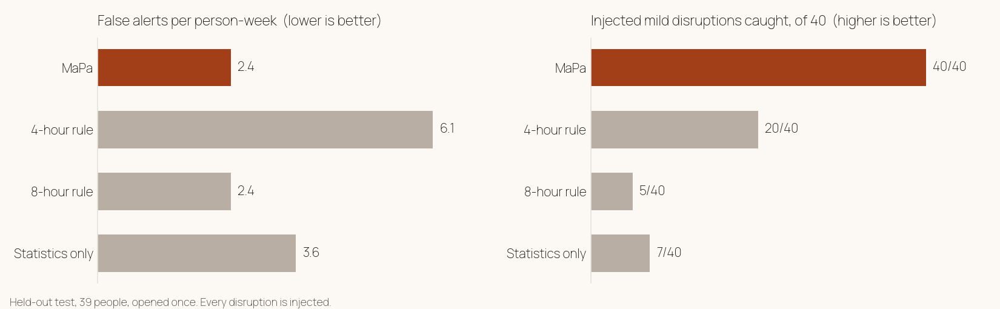

<div align="center">


<br>

**A small AI model on your parent's phone learns their daily rhythm.<br>You see one calm picture of their day, and hear the same day when it looks different.**

[**Watch the demo**](#) · [Landing page](#) · [Try the APKs](#try-it-in-2-minutes) · [Model card](models/MODEL_CARD.md) · [Dataset card](data-card/DATASET_CARD.md)

     

</div>

## At a glance

| | |
|---|---|
| **Creative** | Each parent's phone learns that parent's own rhythm, and it works from the first day. No fixed timer. |
| **Technical** | Our own 9,594-parameter model (CNN + GRU + 30-day LSTM), trained from scratch, running on the phone with ExecuTorch. |
| **It works** | Running on a real Pixel 6a with a real Firebase project: 0.36 ms per 15-minute step. |
| **It holds up** | Illness guards, old data never shown as a good day, tested Firestore rules, no AI key in the public app. |
| **Meta** | ExecuTorch on the parent's phone; Meta's Muse Spark open model, served on Baseten, in the family app. |

<div align="center">
<br>
<sub>The family app and the parent app on a Pixel 6a (sample data).</sub>
</div>

## The problem

Many Indian parents live on their own, while their children work in another city or another country.
A daily "Are you up? Did you eat?" call feels like checking up on them.
Alarm apps wait on a fixed timer and know nothing about the person.

| A 24-hour timer app | MaPa |
|---|---|
| Waits a fixed time, the same for everyone | Learns when *this* parent usually starts and spends the day |
| A quiet morning stays silent until the timer runs out | The family hears the same day when a day looks very different |
| One alarm, nothing in between | One calm picture every day, and an alert only when it matters |

## How it works

<div align="center"></div>

1. **Family sets it up, parent taps Yes.** The parent also allows two permissions: usage access and physical activity.
2. **Every 15 minutes** the parent's phone notes whether it was used. The time only, never which app.
3. **The MaPa Rhythm Hybrid** scores the day against this parent's own rhythm, on the phone.
4. **Only the conclusion travels:** Active, Quiet, Unusual, Monitoring unavailable or Paused by parent.

## The model

| Parameters | Inputs | Step time (Pixel 6a) | On the phone |
|---:|---:|---:|---:|
| 9,594 | 21 per 15 minutes | 0.36 ms | 2 ExecuTorch programs, 103,684 + 123,136 bytes |

A CNN and a GRU read today, a 30-day LSTM reads recent days, and a starting profile lets it work from the first day.
Trained on real smartphone logs, plus parent timelines generated by a statistical model learned from those logs. Every disruption is injected.

## Results

<div align="center"></div>

| Held-out test, 39 people, opened once | False alerts / person-week | Injected caught: mild · clear · severe |
|---|---:|---|
| **MaPa** | **2.4** | **40/40 · 31/31 · 22/22** |
| 4-hour rule | 6.1 | 20/40 · 31/31 · 22/22 |
| 8-hour rule | 2.4 | 5/40 · 10/31 · 22/22 |
| Statistics only | 3.6 | 7/40 · 19/31 · 22/22 |

> [!NOTE]
> **Limits.** Test disruptions are injected, not observed emergencies. Real data is under 1% of training days, and
> the real people were mostly younger than our users. On normal days that only look quiet, MaPa still alerted more
> often than we want (139 of 368 injected normal-quiet episodes). An early pilot with our own parents is planned; we
> make no accuracy claim from it.

## What is real, what is staged

| Real | Staged or sample |
|---|---|
| The model, trained and tested once on held-out people | The sample days shown in the screenshots and the tour |
| The model running on a Pixel 6a with ExecuTorch | Any "Unusual" day shown in the demo video |
| The apps on a real Firebase project, with Google sign-in | The early pilot (planned, not started) |
| Real calls to Meta's Muse Spark open model on Baseten | |

## How we use Meta (with proof)

| | What it does | Code |
|---|---|---|
| **ExecuTorch** | Runs the model on the parent's phone (XNNPACK); matches PyTorch to 2.4e-6 | [export](mapa-android/routine-engine/ml/mapa_train/export_hybrid.py) · [phone loader](mapa-android/app/parent/src/main/kotlin/app/mapa/parent/rhythm/ExecuTorchHybrid.kt) · [pipeline](mapa-android/routine-engine/engine/src/main/kotlin/app/mapa/routine/HybridPipeline.kt) |
| **Muse Spark open model**, via Baseten | Daily note (English, Hindi; Marathi and Tamil after a back-translation check), life tags from the family's words, Ask MaPa. It sees a name-free summary only. | [client](mapa-android/app/core/src/main/kotlin/app/mapa/core/cloud/ChatClient.kt) · [translator](mapa-android/app/core/src/main/kotlin/app/mapa/core/cloud/NoteTranslator.kt) · [spend caps](mapa-android/app/core/src/main/kotlin/app/mapa/core/cloud/AiBudget.kt) |

## Built to hold up

- **Only conclusions leave the phone.** No GPS, camera, microphone, messages or app names. The parent's phone never calls an AI service.
- **Old data is never a good day.** A silent phone shows "Monitoring unavailable".
- **Illness is not learned as normal.** New days wait before they are learned; tagged days (unwell, travelling, guests, festival) are skipped.
- **Security rules with tests.** Firestore rules are tested ([rules tests](mapa-android/app/backend/rules-test)).
- **No AI key in the public app; spend caps** on every cloud call. Health questions are answered on the phone and never sent.

## Reproduce

```bash
cd mapa-android/app
# Phone parity, the full pipeline golden check, rules and wire tests
./gradlew :routine-engine:test :core:test -PmapaModels=../routine-engine/models
# Python features match the phone
cd ../routine-engine/ml && python -m mapa_train.parity --features-only
```

The held-out evaluation needs the MaPa-Rhythm dataset (to be published on Hugging Face).

## Try it in 2 minutes

<details>
<summary><b>Install the APKs</b></summary>

1. Download `MaPa-Parent.apk` and `MaPa-Family.apk` from Releases (link added at release).
2. Family phone: open MaPa Family, tap **Continue with Google**, then **Add a parent**.
3. Parent phone: open the link, tap **Yes, share**, turn on the switch.
4. Android 13 and later: if the switch says "Restricted setting", open App info, tap ⋮, tap **Allow restricted settings**.

</details>

<details>
<summary><b>Build from source</b></summary>

Requirements: JDK 17 and Android SDK 35. `./gradlew :parent:assembleDebug :family:assembleDebug` in `mapa-android/app`.
Without a `google-services.json` the apps use the local Firebase Emulator Suite (`backend/`).

</details>

## Why we built it

> I live away from my parents, and like many adult children, I often wonder how their day is going. Calling them repeatedly isn't practical, and I don't want to make them feel monitored through cameras, GPS trackers or wearables. What I really want is a simple way to know whether their everyday routine seems normal. MaPa uses the smartphone they already carry to learn their activity patterns and identify unusual periods of inactivity. With their consent, it helps families know when a gentle check-in might be worthwhile, without compromising their privacy or independence.
>
> — Shreyash Sharma, founder

<details>
<summary><b>Repository map</b></summary>

| Folder | Contents |
|---|---|
| [`mapa-android/app`](mapa-android/app) | Parent and family apps (Kotlin, Jetpack Compose), Firebase rules |
| [`mapa-android/routine-engine`](mapa-android/routine-engine) | On-device engine, the Kotlin model, parity tests, training code (`ml/`) |
| [`models`](models) | The two ExecuTorch programs and the model card |
| [`data-card`](data-card) | Dataset card, licences and credits |
| [`landing_site`](landing_site) | The landing page (Next.js) |
| [`docs`](docs) | Design notes, status, submission text |

</details>

## Licence and credits

Code and model: [Apache 2.0](LICENSE). Please keep the [NOTICE](NOTICE) and cite with [CITATION.cff](CITATION.cff).
Data sources (CC BY 4.0): the S3 dataset (Espin Lopez et al., figshare) and UbiqLog (Rawassizadeh, UCI).
Methods we built on: Shen et al. 2025, Gibietz et al. 2026, Cejudo et al. 2025 (cited in the model card).

<div align="center"><sub>MaPa · for families who live apart</sub></div>
