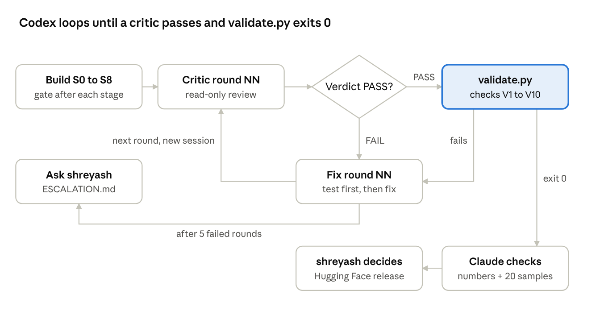

# MaPa-Syn Dataset Design v0.1

Oct 27, 2026 · @shreyash

MaPa-Syn is a benchmark of real phone-use days with labeled, injected disruptions. It tests one question: can a small rhythm model tell unusual non-use, normal quiet, and lost observation apart, without false alarms?

- **Base:** real 15-minute bins from licensed datasets. No new collection for v0.1.
- **Labels:** every episode carries two labels. Label 1 is what we injected. Label 2 is what MaPa must do.
- **Splits:** we split by person before any injection. One person never appears in two splits.
- **Metrics:** false alerts on untouched real days and catch rate on injected events are two separate numbers. We never merge them.
- **Release:** generator, specs, labels, metrics and fully synthetic timelines go public. Real bins go public only where the licence allows it.
- **Limit:** a caught injection is not a caught emergency. MaPa-Syn makes no medical or safety claim.

This doc corrects the GPT proposal in four places. UbiqLog is CC BY 4.0, but it has no screen events and it holds location, which we must drop. Rice LiveLab forbids redistribution, so it is a design reference only. The 342-person set has no stated licence, so it is test-only. No set gives per-person ages; S3 gives only a group range of 18 to 70. The details are in the next section.

## Spec change v0.1.1: real data is a small check, not the benchmark

This section overrides every other section where they differ (decided 2026-10-27 after the Codex heartbeat probe). Real logs record only app sessions, so real quiet time is mostly unobservable. The behaviour benchmark therefore runs on synthetic parents. Real data gives a small, clearly labeled check.

**Probe results (Codex, 2026-10-27)**

| Source | People with strict heartbeat | Strict 3 h window starts | People with eligible daytime starts | Notes |
| --- | --- | --- | --- | --- |
| S3 | 20 | 0 | 0 | Motion rows are not continuous (0 to 8% of each day). No quiet windows. |
| UbiqLog | 34 | 5,221 (overlapping) | 11 | 5 people give about 95% of the starts. Several people have clock spans of 381 to 12,432 days. |
| Synthetic parents | 200 | all | 200 | 120 days each, seed 20261031, no events |

**Decisions**

1. **Primary benchmark: synthetic parents.** All ten scenarios run here. Split by parent 70/15/15 before injection. All headline numbers come from this set and say "synthetic".
2. **S3: no behaviour or quiet episodes.** Use S3 only for next-interaction log-loss on strict bins. Report 0 real behaviour episodes with the reason "no observed 3 h windows".
3. **UbiqLog: evaluation only.** 11 people are too few to split (a 15% test split holds 1 or 2 people). In v0.1, no model trains on UbiqLog. All 11 people form the group `real_check`.
4. **Clock anomalies.** People whose calendar span is more than 2 times their recorded days (p015, p022, p024, p026, p030) are a separate subgroup. Report results with and without them. The headline real number excludes them.
5. **Independent windows.** Use non-overlapping 3 h windows only. At most one window per person per day. At most 10 episodes per person per scenario. Report each person's result, then a pooled result with a per-person bootstrap.
6. **Inferred quiet.** A strict 3 h window with zero foreground count is a real hard negative for scenario 4. Label it `quiet_inferred`. Every text that uses it says "inferred, not verified non-use".
7. **Long severities.** A real episode needs a strict window as long as the injected gap. If none exists, write 0 episodes with the reason.
8. **Gate V8** counts synthetic plus real episodes. Real counts are always reported separately.
9. **Data root** is `D:\GitHub\MaPa\data\MaPaData\`, which is gitignored. It replaces `D:\MaPaData\` in this doc.
10. **Claims.** The card, the report and the pitch say: "Behaviour results are on synthetic parents. A real check on up to 11 UbiqLog people uses inferred observation."

Next step for Codex: lift the review gate and continue from S3 (split) under these rules.

## Spec change v0.1.2: learned non-use generator

This section overrides v0.1.1 and all older sections where they differ (decided 2026-10-27). We replace hand-written non-use with a generator learned from real phone logs. The hand-written generator stays as a baseline.

**Honest wording (use exactly this in the card, report and pitch)**

- Allowed: "MaPa is pretrained on real smartphone logs. Its non-use data comes from a statistical model learned from real phone use."
- Not allowed: "pretrained on real non-use data", or any wording that calls generated timelines real.

**Data roles**

| Group | People | Role |
| --- | --- | --- |
| `gen_fit` | All S3 people + UbiqLog people NOT in `real_check` | Fit the generator. Pretrain the model on their observed bins. |
| `real_check` | The 11 UbiqLog people with eligible daytime windows | Never used to fit or train. Evaluation only. |
| `synth_learned` | 200 sampled parents x 120 days | New primary benchmark. Split 70/15/15 by parent. |
| `synth_hand` | Existing 200 hand-written parents (seed 20261031) | Baseline benchmark. Split 70/15/15 by parent. |

**Generator: hidden semi-Markov model (HSMM)**

1. States: `in_use`, `short_break`, `long_quiet`, `night`.
2. Each state has its own duration distribution, conditioned on hour block (six 4-hour blocks) and weekday or weekend.
3. Quiet lengths come from UbiqLog strict-heartbeat windows in `gen_fit`. A window that ends because the heartbeat stops is right-censored. Use a survival estimate (Kaplan-Meier or a censored log-normal fit). Never treat a censored length as a complete one.
4. Session structure (session length, count per bin) comes from S3 and UbiqLog observed bins in `gen_fit`.
5. Night: the sources barely cover night. Use the night block of the hand-written generator and mark it as an assumption.
6. Person variety: fit parameters per person, then sample new parents from the population of fitted parameters (log-space Gaussian with shrinkage). Never copy one real person's parameters exactly.
7. Age layer: the sources are mostly younger adults. Rescale session rate and daily use to the over-60 aggregates in `routine-engine/CALIBRATION.md`. Write every scaled parameter and its citation to `generator_card.md`.
8. Implement with numpy and scipy only. No neural generator in v0.1.

**Fidelity gates (a sampled set must pass all of these before injection)**

| # | Check | Pass rule |
| --- | --- | --- |
| F1 | Quiet-length distribution vs held-out `gen_fit` people | KS distance reported; must beat `synth_hand` on the same test |
| F2 | Hour-of-day use profile | Correlation with real profile reported; must beat `synth_hand` |
| F3 | Sessions per day | Median within the real interquartile range (after the age layer, within the cited aggregate) |
| F4 | Real vs synthetic classifier (logistic regression on day features) | AUC reported; lower is better; must beat `synth_hand` |
| F5 | Privacy | No synthetic day equals a real day (nearest-neighbour distance > 0 on every day) |

Fit held-out for F1 to F4: split `gen_fit` people 80/20; fit on 80%, check on 20%.

**Experiments (all reported, none hidden)**

| Model | Pretraining | Fine-tune | Evaluated on |
| --- | --- | --- | --- |
| A | `synth_hand` | none | `synth_hand` test, `synth_learned` test, `real_check` |
| B | `gen_fit` real bins (next-interaction) + `synth_learned` | none | same three |
| Baselines | 4 h rule, statistics only | none | same three |

Headline: model B on `synth_learned` test and on `real_check`. Show A vs B side by side. If B is not better on `real_check`, we say so.

**New stages (between S2 and S3)**

| Stage | Command | Writes | Gate |
| --- | --- | --- | --- |
| S2a Fit | `python -m mapa_syn genfit` | `generator\params.json`, `generator_card.md` | Uses only `gen_fit`. Test proves `real_check` pids are never read. Censoring is handled. |
| S2b Sample | `python -m mapa_syn gensample --parents 200 --days 120 --seed 20261101` | `converted\synth_learned\` | F1 to F5 pass. All bins have `observation_basis=synthetic_learned`. |

Code goes in `ml/mapa_syn/generator/` (`hsmm.py`, `fit.py`, `sample.py`, `fidelity.py`) with tests in `tests/mapa_syn/test_generator.py`. The critic checklist gains two rows: "`real_check` never read by genfit or training" (blocker) and "honest wording" (blocker).

## Spec change v0.1.3: fair retry of the learned generator

The first `synth_learned` sample failed F1, F2 and F4 against `synth_hand` (2026-10-27). It stays a failed diagnostic. Two test-design flaws may explain part of it, so we fix the test before we change the generator.

**Test fixes (apply to both generators the same way)**

1. **Age layer after fidelity.** F1 to F4 compare against real people who are mostly younger. Run F1 to F4 on the learned generator before the over-60 age layer. Apply the age layer after it passes. `synth_hand` is compared as it is, and the report says so.
2. **Same observation mask.** Real held-out data is session-only. Before F1, F2 and F4, apply the real observation mask (strict-heartbeat bins only, same censoring) to the synthetic days too. Compare only what the real data can see.

**No tuning on the test**

3. Split `gen_fit` people 60/20/20: fit, tune, fidelity-test. Freeze the split now. Choose all generator settings on the tune set only. Run F1 to F5 on the fidelity-test set once per candidate. Log every candidate and its scores, including losers.

**Allowed generator changes (at most 4 candidates)**

4. Pool quiet lengths across people (hierarchical shrinkage), because 111 complete lengths are too few per person.
5. Use fewer condition cells: 3 hour blocks instead of 6, no weekday split.
6. Non-parametric quiet lengths: censored Kaplan-Meier, sampled by inverse CDF.
7. Hybrid: `synth_hand` day structure plus learned quiet lengths only.

**Decision rule**

8. If one candidate beats `synth_hand` on F1, F2 and F4 and passes F3 and F5, it becomes `synth_learned`.
9. If no candidate passes, `synth_hand` stays primary. We report the learned generator as a negative result in the card. The honest wording then becomes: "MaPa is pretrained on real smartphone logs and on synthetic parents calibrated to published over-60 studies."

## Spec change v0.1.4: derived-data toolkit and honest steering

This section overrides v0.1.3 where they differ (decided 2026-10-28). We use the full ML toolbox to make the derived data as realistic as possible. We steer toward realism, never toward our own scores.

**Naming and provenance**

1. "Derived data" is an allowed name for the generated timelines. Every row keeps `provenance` with one of three values: `real_observed`, `model_derived`, `injected`. Nobody may remove or rewrite this column.
2. The card, the report and the pitch say in plain words: "Timelines are generated by models fitted to real phone logs. Every disruption is injected."
3. Never write "real non-use data". Never present derived days as collected days.

**Steering rule (the line we do not cross)**

4. Allowed: choose target properties of the data first (daily count distribution, hourly profile, quiet-length tail, cited over-60 aggregates). Then solve for the generator parameters that produce them.
5. Not allowed: tune data toward detector scores (catch rate, false alerts, AUC of our model). The objective for data generation is realism only.
6. Never tune on the fidelity-test people or on `real_check`. Log every trial, including losers. Budget: 300 trials in total.

**Evaluation protocol (replaces the 9-person test)**

7. Leave-one-person-out (LOPO) over all 44 `gen_fit` people. For each person, fit on the other 43 and test on that person. Pool the results. Report 95% bootstrap intervals by person.
8. F4 uses max(AUC, 1 - AUC). Apply it to `synth_hand` too. The report states that this rule changed after the v0.1.3 results were seen.
9. Promotion rule: a candidate must beat `synth_hand` on F1, F2 and F4 (pooled point estimates) and pass F3 and F5. If the intervals overlap, the card says "not significant".

**Toolbox (use any of these; log each one)**

| ID | Technique | Use |
| --- | --- | --- |
| T1 | Self-supervised pretraining (masked-bin and next-bin prediction) on real bins of train people | Gives the rhythm backbone real-data weights. This makes the claim "pretrained on real smartphone logs" true. |
| T2 | Maximum-entropy / moment matching | Match target moments with the least extra assumption |
| T3 | Simulation-based inference (ABC-SMC, or scipy differential evolution on summary statistics) | Find generator parameters that reproduce real summary statistics |
| T4 | Importance reweighting | Shift young-adult marginals toward cited over-60 aggregates |
| T5 | Quantile mapping | Match duration distributions to targets |
| T6 | Hierarchical Bayesian partial pooling | Share strength across people with few quiet events |
| T7 | Discrete-time hazard / survival models | Model gaps without treating censored runs as complete |
| T8 | Augmentation: time-warp up to 30 min, within-person block shuffle, day-feature mixup | Train split only |
| T9 | Hard-negative mining | Train split only. List derived days where the 4 h rule or statistics-only detector gives a false alert. |
| T10 | Conformal alert thresholds per person | Calibrate on train days. Test coverage on held-out days. Supports "never cry wolf". |
| T11 | Ensembles of generators | Allowed if each member is logged |

**More real data**

12. Leiden raw data: shreyash sends the request email. Codex does not send email.
13. StudentLife (48 students, phone-lock sessions with start and end times): the page states no licence, so it is eval-only. Convert lock intervals to bins (unlocked = complement of locked). Cite the paper. Never release its bins.
14. Telefonica (342 people) and LSApp: eval-only, as before.
15. Codex downloads only what needs no login. For every set, save the licence text. If the licence is unclear, the set is eval-only.

**Stages**

| Stage | Command | Gate |
| --- | --- | --- |
| S2c Pretrain | `python -m mapa_syn pretrain` | T1 runs on train people only. Test proves `real_check` and LOPO-held-out people are never read. |
| S2d Steer | `python -m mapa_syn steer` | T2 to T7 candidates, at most 300 trials, all in `generator/trials.csv` |
| S2e Fidelity | `python -m mapa_syn fidelity --lopo` | Pooled F1 to F5 with intervals for each candidate and for `synth_hand` |

Decision by end of 2026-10-29. If no candidate is promoted, `synth_hand` stays primary and the card uses the fallback wording. The hackathon deadline is 2026-11-04 21:00 ET.

## Spec change v0.1.5: hackathon mode

This section overrides v0.1.3 and v0.1.4 where they differ (decided 2026-10-28). The goal is a fast, honest, impressive result before the hackathon deadline (2026-11-04 21:00 ET). It is not a peer-review study.

**Decisions**

1. Candidate `censored_km` becomes `synth_learned`. `synth_hand` stays as the baseline. The card shows all fidelity numbers for both sets, including the bad ones (F1 is worse than hand).
2. Dropped: leave-one-person-out testing, bootstrap intervals, the 300-trial search, repeated critic rounds.
3. Kept: provenance column on every row (`real_observed`, `model_derived`, `injected`); split by person; `real_check` never read; stale-as-fresh = 0; no medical claims; licence check before anything goes public; no upload without shreyash's yes.
4. Headline technique: self-supervised pretraining (masked-bin and next-bin) on real bins of `gen_fit` train people. Then "pretrained on real smartphone logs" is true.
5. Wording: "Timelines are generated by models fitted to real phone logs. Every disruption is injected."

**Order of work**

| Day | Work |
| --- | --- |
| Oct 28 | Promote `censored_km`. Pretrain. Run S3 (split), S4 (gaps) and S5 (inject 10 scenarios) on both sets. |
| Oct 29 | S6 and S7: trace the 4 h rule, statistics-only and our model. One results table. |
| Oct 30 | Dataset card. Hugging Face dry run. shreyash approves before upload. |
| Oct 31 to Nov 3 | Buffer for demo, video and pitch. |

**One automated check** replaces the critic loop: no person in two splits, `real_check` never read, no forbidden fields, stale-as-fresh = 0.

## Spec change v0.1.7: final-v3 with unlock and movement signals

Decided 2026-10-28 (shreyash: "add unlocks and movement only data as well"). Do not touch `final-v2`. Build `final-v3` beside it.

**New columns per 15-minute bin**

| Column | Meaning |
| --- | --- |
| `unlock_count` | Unlocks in the bin |
| `unlock_len_s` | Total unlocked seconds in the bin |
| `session_count` | Use sessions that start in the bin |
| `move_level` | Movement level 0 to 3 (none, light, moderate, strong) |
| `move_frac` | Fraction of the bin with movement |

Every new column has a companion `<col>_src` with `real_observed`, `model_derived` or `unobserved` (-1 value). The row-level `provenance` column stays.

**Rules**

1. Real logs give what they have. Never fill a real gap with a made-up value labelled real. Use -1 and `unobserved`.
2. Derived parents get the new signals from the same fitted statistical model (same fit, same seed rules), labelled `model_derived`. Conditioning: unlocks and sessions follow the in_use state; movement follows the person's hourly profile and state.
3. Splits and test people stay exactly as in `final-v2`. Check with a test that compares person lists.
4. Episodes: injected disruptions change the new signals consistently. Example: phone left at home gives unlocks 0 and movement 0 together with the other signals. Observation failures (app killed, permission revoked) set new columns to -1.
5. Manifest lists SHA-256 for every file, row counts, the real versus derived share per column, and the `final-v2` hashes it did not change.
6. Fidelity: repeat the F1 to F5 table and add the hourly profile of unlock count and movement, derived versus observed.
7. Make `final-v3` read-only after its test passes. Codex retrains the winning design on `final-v3` by 2026-10-31.

## Source datasets

S3 and UbiqLog are the only sets we may train on and partly release. The others are test-only or design references. I checked each official page on 2026-10-27. "Not stated" means the page does not say it, so Codex must check the files.

| Dataset | People, span | Licence and redistribution | Ages | Fine timestamps | Channels useful to MaPa | Our role |
| --- | --- | --- | --- | --- | --- | --- |
| [S3](https://ieee-dataport.org/open-access/s3-dataset) (figshare 14410229) | 21, 60+ days | CC BY 4.0 on figshare (checked in the hackathon thread). IEEE DataPort copy needs a subscription; use figshare. | 18 to 70, group range only. Per-person age not described. | App stats every 60 s, inertial features every 20 s. Timestamp format not stated. | App foreground counts, motion features | Train + test. Drop the voice x-vectors. |
| [UbiqLog](https://archive.ics.uci.edu/dataset/369/ubiqlog+smartphone+lifelogging) (UCI) | 35, about 2 months | CC BY 4.0. Must not harm participant privacy or re-identify anyone. | Not stated | Not stated; JSON records | App use, calls, SMS headers, activity. No screen events. | Train + test. Drop location, WiFi, Bluetooth, call and SMS detail. |
| [Mobile Phone Use / Pielot](https://sites.google.com/view/mobile-phone-use-dataset) | 342, several weeks (2016) | No licence stated. Cite the UbiComp 2017 paper. | Not stated | Not stated | 25 sensors incl. foreground app and notifications. Screen and battery are not named on the page. | Test only. No weights, no derived bins in the release. |
| [Rice LiveLab](https://www.yecl.org/livelab/traces.html) | Not stated | No redistribution without written permission. No re-identification. | Not stated | Yes, SQL tables | display, charging, power\_detail, loggeron | Design reference for failure scenarios. Private test at most. Never in the release. |
| [UniMiB SHAR](https://ar5iv.arxiv.org/html/1611.07688) | 30, lab sessions | No licence found in the paper. Must ask the authors before release. | 18 to 60, mean 27 | 3 s windows at 50 Hz | Accelerometer: 8 fall types, 9 daily activities | Not v0.1. Later experimental extension only. |
| LSApp, Leiden derived data | 292; 598 | No licence (LSApp); Leiden raw by request | Leiden 16 to 86 | App open and close times | App sessions | Test only, as in the hackathon brief. |

Two hard limits. First, no open set has per-person ages with fine timestamps, so v0.1 does not condition on age. Second, real data has no labeled emergencies, so every positive label in MaPa-Syn is injected.

## Scenario list (v0.1)

v0.1 has ten scenarios in two groups: six behaviour scenarios and four observation failures. All of them edit the bins format that the harness already reads (`interactions, phone_on, usage_ok, network_ok, charging, battery, paused, moved`). The expected states are the five engine states: ACTIVE, QUIET, UNUSUAL\_INACTIVITY, MONITORING\_UNAVAILABLE, PAUSED\_BY\_PARENT.

| # | Scenario | What the generator changes | Expected system response | Type |
| --- | --- | --- | --- | --- |
| 1 | Daytime inactivity | Set `interactions=0` and `moved=0` for 3, 5, 8 or 12 h, start 08:00 to 18:00. Keep `phone_on=1`. | UNUSUAL\_INACTIVITY + family alert, if the gap is past this person's learned limit. Else QUIET. | Positive |
| 2 | Delayed morning | Move the first interaction of the day 1, 2 or 3 h later. Remove the use before it. | UNUSUAL\_INACTIVITY after the person's normal wake window, not before 07:00 | Positive |
| 3 | Phone left at home | Same as 1, plus `moved=0` and `charging` unchanged. Device stays healthy. | UNUSUAL\_INACTIVITY. The phone cannot tell this from 1. The note must not guess a cause. | Positive (by design) |
| 4 | Normal long silence | No change. Pick real quiet windows of 3+ h that match the person's own history (naps, temple, TV). | ACTIVE or QUIET. No alert. | Hard negative |
| 5 | Routine shift | Shift all use by +2 or -2 h for 7 to 14 days in a row. | Alerts allowed on day 1 to 2 only. Then a "new routine?" prompt to family. The model must not learn it without family confirmation. | Mixed |
| 6 | Life tag day | Inject silence as in 1, but add a family life tag (travel, guests). | QUIET with tag. No alert. Day excluded from training. | Hard negative |
| 7 | Network outage | Set `network_ok=0` for 2 to 24 h. Local bins keep real use. Server sees no upload, then a backfill. | MONITORING\_UNAVAILABLE on the family side. Never an all-clear. After backfill, replay must match real use. | Observation |
| 8 | App killed by OS | Delete all bins in the window (no heartbeat). | MONITORING\_UNAVAILABLE + stale notice after the freshness limit | Observation |
| 9 | Battery dead | Ramp `battery` down to 0 over 2 to 6 h, then delete bins until a charge event. | lowBattery alert before 0, then MONITORING\_UNAVAILABLE | Observation |
| 10 | Permission revoked | Set `usage_ok=0` and `interactions=-1`. Heartbeat continues. | MONITORING\_UNAVAILABLE with reason "usage access off". Never QUIET. | Observation |

"Charging but unused" is a variant of 1, not its own scenario: `charging=1` for the whole window. A plug-in event is a sign of life, but staying on charge is not. Night rules still apply to all ten: the engine holds alerts from 22:00 to 07:00.

Each positive scenario runs at three severities (mild, clear, severe), so we can plot the catch rate against gap length. A sanity rule: the generator first measures each person's own gap distribution. A 3 h gap is "severe" for one person and normal for another.

## Two-label schema

Every episode has two labels that we never merge. Label 1 (`injected`) says what the generator changed. Label 2 (`expected`) says what MaPa must show and send. A test passes or fails on label 2 only. Label 1 lets us explain the result.

Severity is relative to the person. The generator reads the person's gap distribution from all observed days before the injected day, as the phone would. It never reads later days. Mild = gap at their 90th percentile, clear = 97th, severe = 99.5th or more. It writes the percentile into the record.

One record per episode, in `episodes.jsonl`:

```json
{
  "episode_id": "s3-p07-e0042",
  "source": "s3",
  "pid": "s3-p07",
  "split": "test",
  "seed": 20261027,
  "day_index": 41,
  "scenario": "daytime_inactivity",
  "injected": {
    "kind": "interaction_silence",
    "start_bin": 3940,
    "end_bin": 3960,
    "duration_min": 300,
    "severity": "clear",
    "person_gap_percentile": 97.4,
    "channels_changed": ["interactions", "moved"],
    "channels_kept": ["phone_on", "network_ok", "usage_ok", "battery"],
    "simulated_channels": ["network_ok"]
  },
  "expected": {
    "state": "UNUSUAL_INACTIVITY",
    "alert": "unusual",
    "alert_after_bin": 3948,
    "alert_deadline_bin": 3956,
    "all_clear_allowed": false
  },
  "ground_truth": {
    "real_world_event": "unknown"
  }
}
```

Field rules:

- `expected.state` uses the five engine states. `expected.alert` is one of `none`, `unusual`, `lowBattery`, `stale`.
- `alert_after_bin` and `alert_deadline_bin` give a window. An alert before the window is a false alert. No alert by the deadline is a miss.
- `simulated_channels` lists every channel the source never recorded. Example: S3 has no network state, so we write `network_ok=1` and mark it as simulated.
- `ground_truth.real_world_event` is always `unknown`. We never claim to know what happened to the person.
- Hard negatives (scenarios 4 and 6) use the same record with `expected.alert = none`. Untouched real days get no record; every alert on them counts as false.

## Splits

We split whole people first, then inject. This order stops one person's days from leaking into both train and test.

1. Convert each dataset to bins. Drop people with fewer than 28 observed days.
2. Assign each person to train (70%), validate (15%) or test (15%) with a fixed seed, per dataset. Write `splits.csv` (`pid, source, split`) and freeze it. Never re-draw it after we see results.
3. Inside each person, days 1 to 14 stay untouched. This matches on-phone learning: the personal head trains on these days. Injections start on day 15.
4. Inject with a different seed per split (train, validate, test). Test parameters are not visible to training code.
5. Train and validate timelines get at most one injected episode per person per week, so the baseline stays real. Test episodes are different: each test episode is its own copy of the person's timeline with exactly one injection (see "Episode count").
6. Add one cross-dataset test: train on S3 people, test on UbiqLog people, and the reverse. This checks that the model learns rhythm, not one study's logging style.
7. Test-only sets (Pielot, LSApp, Leiden) are a fourth group, `external_test`. They never touch training or tuning.

With about 56 usable people (21 S3 + 35 UbiqLog, before dropouts), the test split has about 8 people. That is small. We report confidence intervals with a per-person bootstrap and say the count next to every number.

## Metrics

We report two headline numbers and never combine them into one score. False alerts come from untouched real days. Catch rate comes from injected episodes.

| Metric | Measured on | Definition | Target for v0.1 |
| --- | --- | --- | --- |
| False alerts per person-week | Untouched real days of test people, plus hard negatives (scenarios 4, 6) | Count of `unusual` alerts / person-weeks | Lower than the 4 h rule on the same days |
| Catch rate | Injected positives (scenarios 1, 2, 3, 5) | Share with an alert inside the window, by severity | Report per severity; no single target |
| Time to alert | Caught positives | Minutes from gap start to alert, median and 90th percentile | Report only |
| Stale-as-fresh | Observation scenarios (7 to 10) | Share of bins where the family side shows ACTIVE or QUIET while data is missing | 0, a hard gate |
| Correct failure reason | Scenarios 7 to 10 | Share where the stale reason matches (network, app, battery, permission) | Report only |
| Next-interaction log-loss | Untouched test days | Model fit, as in the hackathon brief | Report only |

Rules for every number:

- Write the count of people and episodes beside it, and a 95% interval from a per-person bootstrap.
- Label it "real days" or "injected". Never write "accuracy" alone.
- Compare the same baselines as the harness: 4 h rule, 8 h floor, statistics only, GRU, CNN.
- Stale-as-fresh above 0 blocks a release, whatever the other numbers say.

## What we can release on Hugging Face

We can release everything we write, plus derived bins from the two CC BY 4.0 sets. Nothing goes public until shreyash says yes.

| Item | Release? | Why |
| --- | --- | --- |
| Generator code, converters, metric scripts | Yes (Apache 2.0) | Our own code |
| Spec: bins format, `episodes.jsonl` schema, scenario list | Yes | Our own work |
| Fully synthetic parents + injections | Yes | No real person behind them |
| S3 and UbiqLog derived 15-min bins + labels | Yes, with attribution (CC BY 4.0) | Licence allows it. We keep counts only, no app names, no location, no voice data. Calendar dates become day index and weekday. |
| `splits.csv`, seeds, manifests | Yes | Lets others reproduce the numbers |
| Model weights trained on synthetic + S3 + UbiqLog | Yes, with attribution | Licence allows derived work |
| Pielot, LSApp, Leiden bins or labels | No | No licence. We publish only aggregate scores on them. |
| Rice LiveLab anything | No | Redistribution needs written permission |
| UniMiB SHAR windows | No, until the authors agree | No licence found |

The dataset card states: built for routine-gap research; not a medical device; a caught injection is not a caught emergency; ages are group ranges only; real positives do not exist in the data.

## v0.1 scope and Codex brief

v0.1 is S3 + UbiqLog, the ten scenarios, and two baselines against our model. It fits inside the hackathon window because it reuses the harness bins format.

**In v0.1**

- Sources: S3 and UbiqLog for train and test. Pielot and LSApp as `external_test`.
- Ten scenarios, three severities each.
- Episode count: each test person-week is replayed once per scenario and severity, as separate runs. About 8 test people × 6 weeks × 10 scenarios × 3 severities gives about 1,400 episodes. These episodes share baselines, so the bootstrap is per person, not per episode.
- Baselines: 4 h rule and statistics only, against GRU and CNN.
- Outputs: `bins.csv.gz`, `episodes.jsonl`, `splits.csv`, `injection_manifest.json`, `people.csv` (age group or `unknown`), dataset card.

**Not in v0.1:** age conditioning, the delayed and duplicated events case, time-zone change, the multilingual check-in reply set, and anything from LiveLab.

**Codex work:** the next seven sections are the complete Codex brief. They replace section 7 of the hackathon brief for MaPa-Syn work.

## Folder structure

Code goes in the repo. Data goes on the D: drive, outside the repo. Codex must never write data into the repo or into git.

**Code: new Python package next to the rhythm model**

Root: `mapa-android/routine-engine/` (in shreyash's copy: `D:\GitHub\MaPa\mapa-android\routine-engine\`).

```text
routine-engine/
  data/harness/                 existing synthetic parents (do not change)
  harness/                      existing Kotlin harness (add one "trace" mode only)
  models/                       existing weights (do not change)
  ml/
    mapa_rhythm/                existing model code (do not change in this work)
    mapa_syn/                   NEW
      __init__.py
      __main__.py               python -m mapa_syn <stage> --config ...
      paths.py                  reads MAPA_DATA (default D:\MaPaData)
      config/
        v0.1.yaml               seeds, sources, split shares, severities
        scenarios.yaml          the 10 scenarios and their parameters
      sources/
        s3.py  ubiqlog.py  pielot.py  lsapp.py   one converter per dataset
      bins.py                   common bins writer and schema check
      splits.py
      gaps.py                   per-person gap distribution (causal)
      scenarios/
        base.py                 Scenario class: apply(), expected()
        daytime_inactivity.py  delayed_morning.py  phone_left_home.py
        normal_long_silence.py routine_shift.py    life_tag_day.py
        network_outage.py      app_killed.py       battery_dead.py
        permission_revoked.py
      inject.py                 builds episodes and variant timelines
      export_harness.py         writes harness-format folders per split
      baselines.py              4 h rule and statistics-only detectors
      evaluate.py               scores traces against episodes.jsonl
      critic.py                 automated critic checks (critic mode)
      validate.py               final gates (exit 0 = done)
      release.py                stages releasable files only
      card/DATASET_CARD.md      template for the Hugging Face card
    tests/mapa_syn/
      fixtures/                 3 fake people, 21 days each, hand-made
      test_sources.py  test_splits.py  test_gaps.py
      test_scenarios.py         one test per scenario
      test_inject.py  test_evaluate.py  test_critic.py
```

**Data: outside the repo**

```text
D:\MaPaData\
  raw\<source>\                 untouched download
    LICENCE.txt                 licence text as published
    SOURCE.md                   URL, download date, file list, SHA-256
  converted\<source>\
    bins.csv.gz  parents.csv  people.csv
    README.md                   exact conversion rule for this source
    SUMMARY.md                  people, days, missing share, age groups
  mapa-syn\v0.1\
    splits.csv                  frozen; its SHA-256 goes in manifest
    gaps\<split>.csv            per-person gap percentiles
    episodes\<split>\episodes.jsonl
    harness\<split>\            bins.csv.gz parents.csv episodes.csv (harness format)
    traces\<detector>\<split>.csv.gz   pid,t,state,alert,reason
    eval\results.json  eval\REPORT.md
    injection_manifest.json     seeds, config hash, counts, file hashes
    reviews\critic-round-01.md  ... one file per critic round
    fixes\fix-round-01.md       ... one file per fix round
    VALIDATION.md               output of validate.py
    release\                    staging for Hugging Face; releasable items only
  logs\                         one log per command run
```

Rules: `D:\MaPaData\` is in the global gitignore. `release\` holds only what the release table allows. Converters read `raw\` and never edit it.

## End-to-end flow

Codex works in one loop: build, critic, fix, critic again, until the critic passes and `validate.py` exits 0. Only then does the work come back to shreyash for review.



Flow: Build S0 to S8 -> Critic round (read-only, new session) -> PASS? If FAIL: Fix round (test first) -> next critic round; after 5 failed rounds ask shreyash (ESCALATION.md). If PASS: validate.py (V1 to V10); fails -> Fix round; exit 0 -> shreyash checks numbers and 20 samples -> shreyash decides the Hugging Face release.

Every critic round runs in a new session, so the critic never reviews its own code. After five failed rounds, Codex stops and asks shreyash.

## Build stages

Codex builds in nine stages, in this order. Each stage ends with a gate. Codex does not start the next stage until the gate passes. Run all commands from `routine-engine/ml/` with `MAPA_DATA=D:\MaPaData`.

| Stage | Command | Writes | Gate (must pass) |
| --- | --- | --- | --- |
| S0 Setup | `python -m pytest tests/mapa_syn -q` | folders, gitignore entry | Python 3.11+. `MAPA_DATA` exists and is outside the repo. `git check-ignore D:\MaPaData` is true. Fixture tests pass. |
| S1 Acquire | `python -m mapa_syn acquire --source s3` (then `ubiqlog`, `pielot`, `lsapp`) | `raw\<source>\`, `LICENCE.txt`, `SOURCE.md` | Licence text is saved. S3 and UbiqLog say CC BY 4.0. SHA-256 for every file. No login was needed; if one is, stop and ask shreyash. |
| S2 Convert | `python -m mapa_syn convert --source <name>` | `converted\<source>\*` | Schema check passes. No forbidden field (location, WiFi, Bluetooth, phone number, contact, app name, voice). Missing channels are `-1`. `README.md` and `SUMMARY.md` exist. |
| S3 Split | `python -m mapa_syn split` | `splits.csv` | No pid in two splits. Shares within one person of 70/15/15. People under 28 days are listed as dropped. SHA-256 is stored in the manifest. |
| S4 Gaps | `python -m mapa_syn gaps` | `gaps\<split>.csv` | Causal: a test changes days after day d and checks that the gaps at day d do not change. |
| S5 Inject | `python -m mapa_syn inject --split <split>` | `episodes.jsonl`, `injection_manifest.json` | One test per scenario passes. Only `channels_changed` differ from the base timeline. No injection on days 1 to 14. Behaviour windows are fully observed in the base. A rerun with the same seed gives the same SHA-256. |
| S6 Export and trace | `python -m mapa_syn export`, then `gradle :harness:run --args="trace <harness dir> <weights> <trace file>"`, then `python -m mapa_syn baselines` | `harness\<split>\`, `traces\<detector>\` | The harness reads every folder. Trace rows = bin rows. Each detector (4 h rule, statistics only, GRU, CNN) has a trace for each split. |
| S7 Evaluate | `python -m mapa_syn evaluate` | `eval\results.json`, `eval\REPORT.md` | Every metric in the Metrics table is present for every detector, with people count, episode count and a 95% interval. |
| S8 Release staging | `python -m mapa_syn release --dry-run` | `release\`, `DATASET_CARD.md` | Only allowed sources. Card has attribution, licence and limits. Nothing is uploaded. |

The Kotlin harness change is small and is the only change outside `mapa_syn`. Add a `trace` mode next to the existing `replay` mode. It writes one row per bin: `pid,t,state,alert,reason`. It must not change the existing harness results.

## Critic mode

The critic is a separate Codex run with a fresh context. It reads this doc and the outputs. It does not edit code or data. Its only output is one review file.

**Rules for the critic**

1. Start a new Codex session. Do not reuse the builder's session.
2. Run `python -m mapa_syn critic --round NN` first. This runs the automated checks below that have code.
3. Then do the manual checks: read the code, open samples, compare with this doc.
4. Every finding needs evidence: a file and line, or a command and its output. No evidence, no finding.
5. Every finding names the doc section it breaks.
6. Write `reviews\critic-round-NN.md`. End it with one line: `VERDICT: PASS` or `VERDICT: FAIL`.
7. PASS means zero blockers and zero majors.

**Severity**

| Severity | Meaning | Examples |
| --- | --- | --- |
| Blocker | Results are wrong or data must not ship | split leak, private field in output, stale shown as fresh, wrong licence in release |
| Major | A spec rule is broken, but results may still be usable | wrong alert window, missing scenario test, non-deterministic output |
| Minor | Style, naming, docs | unclear README, slow code |

**Checklist (every round, every item)**

| Area | Check | Automated? |
| --- | --- | --- |
| Leakage | No pid in two splits. Gap stats never read days after the injected day. Test seeds and test config are not read by training code. | Yes |
| Injection fidelity | Bin-by-bin diff of variant against base: only `channels_changed` differ, only inside the window. | Yes |
| Injection placement | No injection on days 1 to 14. Behaviour windows sit on fully observed bins. Night rule respected (no alert window inside 22:00 to 07:00). | Yes |
| Labels | `expected` follows the scenario table. Severity matches `person_gap_percentile`. Hard negatives have `alert = none`. | Yes |
| Sample review | Open 2 episodes per scenario (20 total). Plot or print the window. Confirm by eye that it matches the scenario. | Manual |
| Privacy | No forbidden fields or free text anywhere in `converted\`, `mapa-syn\` or `release\`. Calendar dates are gone; only day index and weekday remain. | Yes |
| Licence | `release\` holds only S3, UbiqLog and synthetic data. Card names both sources and CC BY 4.0. | Yes |
| Determinism | Rerun S3 to S5 with the same config; all SHA-256 values match the manifest. | Yes |
| Metrics | Every number has people count, episode count, interval, and a "real days" or "injected" label. False alerts and catch rate are never combined. | Yes |
| Safety floor | Stale-as-fresh = 0 for every detector on scenarios 7 to 10. | Yes |
| Repo hygiene | No data files in git. No keys. Existing harness results unchanged. | Yes |
| Honesty | REPORT.md and the card make no medical or safety claim and do not call injected events emergencies. | Manual |

## Fix mode and loop rules

The fixer is the builder session. It reads the latest critic file and fixes every blocker and major. Then a new critic round starts.

1. Read `reviews\critic-round-NN.md`. Fix blockers first, then majors. Minors are optional.
2. For each finding, add a test that fails before the fix and passes after it. Name it after the finding, for example `test_r02_f03_window_leak`.
3. Rerun from the earliest stage the fix touches. Example: a fix in `gaps.py` reruns S4 to S8.
4. Write `fixes\fix-round-NN.md`: one row per finding with status (fixed, disputed, deferred), the commit hash and the new test name.
5. "Disputed" needs a reason that quotes this doc. The next critic decides. A disputed blocker that the critic keeps goes to shreyash.
6. Start critic round NN+1 in a new session.

**Loop limits**

- Stop after 5 critic rounds without a PASS. Write `ESCALATION.md` with the open findings and ask shreyash.
- Stop at once and ask shreyash if: a licence is unclear, a download needs a login, a fix needs a change to this spec, or a fix needs a change in `mapa_rhythm/`, the engine or the app.
- Never weaken a gate, skip a test, or delete a check to reach PASS. That counts as a blocker in the next round.

## Final validation (definition of done)

Codex is done only when `python -m mapa_syn validate` exits with code 0. The command checks all ten conditions below and writes `VALIDATION.md`. A Codex message that says "done" without this file does not count.

| # | Condition | How `validate.py` checks it |
| --- | --- | --- |
| V1 | All stage gates S0 to S8 pass | Reruns each gate check on the current files |
| V2 | All tests pass | `pytest tests/mapa_syn` exit 0, and the count of tests is not lower than the last round |
| V3 | Latest critic round says PASS | Last line of the newest `critic-round-NN.md` |
| V4 | No open blocker or major | Every finding in every `fix-round-NN.md` is fixed, or disputed and then accepted by a later critic |
| V5 | Outputs match the manifest | SHA-256 of every output file equals `injection_manifest.json` |
| V6 | Fresh rebuild matches | Rebuilds S3 to S7 into a temp folder and compares hashes |
| V7 | Stale-as-fresh is 0 | Reads `results.json` |
| V8 | Every scenario has episodes in test | At least 20 test episodes per scenario |
| V9 | Release folder is clean | Same licence and privacy checks as the critic |
| V10 | Repo is clean | `git status` shows no data files; existing harness results unchanged |

**After V1 to V10 pass**

1. Codex reports back with the paths of `VALIDATION.md`, `eval\REPORT.md` and the last critic file. It does not train new models and does not upload.
2. A reviewer checks the numbers and the 20 sample episodes.
3. shreyash decides on the Hugging Face release.

## Prompts for Codex

shreyash pastes these into Codex. Each prompt assumes Codex can read this doc as `docs/mapa-syn/DESIGN.md` in the repo.

**1. Builder (one session, stages S0 to S8)**

```text
You are building MaPa-Syn v0.1. Read docs/mapa-syn/DESIGN.md fully before you write code.
Follow the sections "Folder structure" and "Build stages" exactly.
Work stage by stage, S0 to S8. Run the gate of each stage. Do not start the next stage until the gate passes.
Code goes in mapa-android/routine-engine/ml/mapa_syn/ and ml/tests/mapa_syn/. Data goes in D:\MaPaData\ only.
The only change outside mapa_syn is a "trace" mode in the Kotlin harness.
Do not change mapa_rhythm/, the engine, the app, or existing results.
Do not train models. Do not upload anything. Do not commit data. Do not send email.
Stop and ask if a licence is unclear or a download needs a login.
When S8 passes, write a short status in D:\MaPaData\logs\build-status.md and stop.
```

**2. Critic (new session for every round)**

```text
You are the critic for MaPa-Syn v0.1, round NN. You did not write this code.
Read docs/mapa-syn/DESIGN.md, section "Critic mode".
Do not edit code or data. Your only output is D:\MaPaData\mapa-syn\v0.1\reviews\critic-round-NN.md.
Run: python -m mapa_syn critic --round NN. Then do every manual check in the checklist.
Every finding needs: id (rNN-fMM), severity, doc section, evidence (file:line or command + output), and the expected behaviour.
Read the previous fix file and check every "disputed" item. Accept or reject it with a reason.
End the file with one line: VERDICT: PASS or VERDICT: FAIL. PASS means zero blockers and zero majors.
```

**3. Fixer (builder session, after each FAIL)**

```text
Read D:\MaPaData\mapa-syn\v0.1\reviews\critic-round-NN.md and DESIGN.md section "Fix mode and loop rules".
Fix every blocker, then every major. For each one, first add a test that fails, then fix, then show it passes.
Rerun from the earliest stage your fix touches.
Write fixes\fix-round-NN.md with: finding id, status, commit hash, test name.
Never weaken a gate or remove a check.
If this was round 5 and the critic still fails, write ESCALATION.md and stop.
```

**4. Validator (after a critic PASS)**

```text
Run: python -m mapa_syn validate. If it exits 0, report the paths of VALIDATION.md, eval\REPORT.md and the last critic file, then stop.
If it fails, treat each failed condition as a blocker and go back to the fixer prompt.
```

## Later: impact extension (experimental)

Falls and phone drops are a different problem with different sensors. They live in a separate dataset (`mapa-syn-impact`) with its own card marked experimental. UniMiB SHAR has lab-simulated falls by people aged 18 to 60, so it says little about older adults. A phone drop is not a human fall, and we never rename one as the other. We start this only after the authors confirm the licence. MaPa makes no fall-detection claim in v0.1, in the pitch, or in the app.

## Open questions for shreyash

- [ ] Approve release of derived S3 and UbiqLog bins on Hugging Face (after the numbers look right)?
- [ ] Name: keep "MaPa-Syn"? The data is semi-synthetic, so "MaPa-Gap" or "MaPa-Rhythm-Bench" may be more honest.
