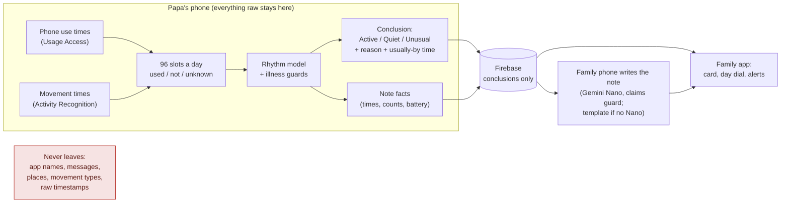
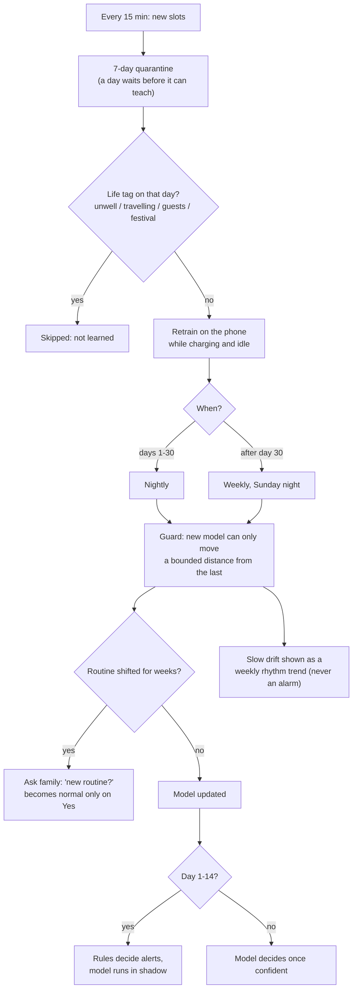
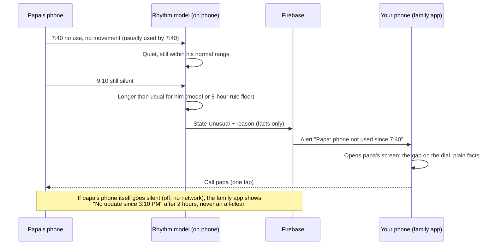
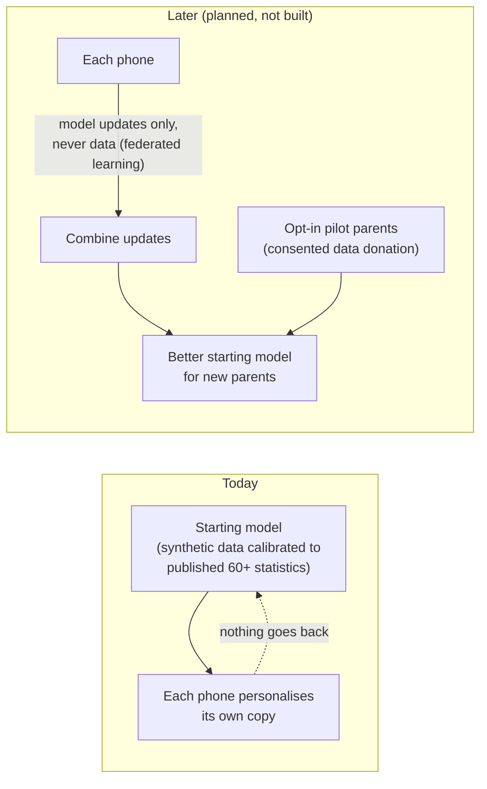

# How MaPa works: four flows (2026-10-19)

## 1. Data: what stays on papa's phone, what leaves

## 2. The learning loop on papa's phone

## 3. An alert: from first silence to the Call button

## 4. Does live data improve the shared starting model?

Today: **no**. Each phone learns only for its own parent and nothing flows back, which keeps the privacy
promise simple. Later: federated learning (phones send model updates, never data) and opt-in data from
pilot families can improve the starting model for new parents. Both need their own consent wording.

**Decision 2026-10-21 (Option C):** the parent's phone runs no language model. It syncs the note's
structured facts; each family member's phone writes the note with Gemini Nano (ML Kit Prompt API) in
that member's language, checked by the claims guard, with the template note as the fallback. Release
sizes: parent app 3.0 MB (was 52 MB with Gemma/MediaPipe), family app 3.5 MB.
